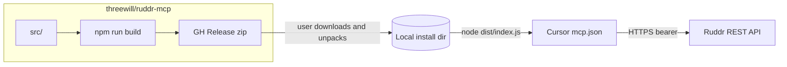

## Context

- A previous hosted Ruddr MCP registration in Cursor was unauthenticated in that setup, so only `mcp_auth` existed.
- The hosted Ruddr MCP bundle evaluated at the time is **read-only and excludes time entries**. This project wants time-entry writes, so we will not depend on it.
- Ruddr publishes a REST API with an OpenAPI spec we can wrap directly:
  - Base URL: `https://www.ruddr.io/api/workspace`
  - Auth: `Authorization: Bearer <API_KEY>` (created in Ruddr Settings → API Keys)
  - OpenAPI: `https://docs.ruddr.io/openapi.json` (LLM index: `https://docs.ruddr.io/llms.txt`)
  - Coverage includes Clients, Projects, Project Members/Tasks/Expenses, Invoices, Timesheets, **Time Entries (CRUD)**, Members, Holidays, Opportunities, etc.
- Team ops documentation lives **outside** this repository. This repo's job is the separately versioned MCP server.

## Repo split

Deliberately separated:

- **This repo — `threewill/ruddr-mcp` (NEW)**
  - Owns: TypeScript MCP server source, OpenAPI-derived types, build, tests, GitHub Releases.
  - Distributed as: versioned zip attached to a GitHub Release (`ruddr-mcp-vX.Y.Z.zip` containing `dist/`, `package.json`, `node_modules/` *or* a single bundled file via `tsup`/`esbuild`).
- **Consumer / ops docs (outside this repo)**
  - Owns: local MCP client registration, install notes, and cleanup of any previous hosted Ruddr MCP registration.
  - Owns no server code.



## Repo A: `threewill/ruddr-mcp`

### Layout

- `package.json` – ESM, deps `@modelcontextprotocol/sdk`, `zod`; dev deps `typescript`, `openapi-typescript`, `tsx`, `tsup` (for single-file bundle).
- `tsconfig.json`, `.gitignore`, `README.md`, `LICENSE`.
- `src/index.ts` – entry: registers tools, starts `StdioServerTransport`.
- `src/client.ts` – thin fetch client: bearer auth, 429 backoff, cursor pagination helper, error normalization.
- `src/types.ts` – generated from `https://docs.ruddr.io/openapi.json` via `openapi-typescript` (committed; `npm run gen:types`).
- `src/tools/clients.ts`, `projects.ts`, `time-entries.ts`, `timesheets.ts`, `members.ts`, `expenses.ts`, `invoices.ts`, `holidays.ts`, `opportunities.ts` – one file per domain. Each exports `register(server)` adding `zod`-validated tools.
- `.github/workflows/release.yml` – on tag `v*`, builds and uploads `ruddr-mcp-vX.Y.Z.zip` (containing `dist/index.js` + `package.json` + `node_modules` for prod deps, or a single bundled `index.js` if we use `tsup --minify`).

### Tools shipped

- **Reads (Phase 1 + 2)**: `ruddr_list_clients`, `ruddr_list_projects`, `ruddr_list_project_members`, `ruddr_list_project_tasks`, `ruddr_list_project_expenses`, `ruddr_list_project_budget_expenses`, `ruddr_list_invoices`, `ruddr_list_expense_categories`, `ruddr_list_expense_items`, `ruddr_list_expense_reports`, `ruddr_list_workspace_members`, `ruddr_list_holidays`, `ruddr_list_opportunity_stages`, plus the **gaps MCP Bundles doesn't cover**: `ruddr_list_time_entries` (filters: `from`, `to`, `memberId`, `projectId`, `timesheetId`, `statusId`), `ruddr_get_time_entry`, `ruddr_list_timesheets`.
- **Writes (Phase 3, gated)**: `ruddr_create_time_entry`, `ruddr_update_time_entry`, `ruddr_delete_time_entry`.
  - Each write tool checks `process.env.RUDDR_ALLOW_WRITES?.split(",").includes("time_entries")` and returns a clear error if not enabled.
  - Tool descriptions instruct the agent to confirm with the user before calling.

### Distribution (GitHub Releases)

- Tagging `v0.1.0` triggers the release workflow.
- Release asset: a single zip the user can unpack to any path. README includes:
  - Linux/macOS install: `unzip ruddr-mcp-v0.1.0.zip -d ~/tools/ruddr-mcp`
  - Windows install: `Expand-Archive .\ruddr-mcp-v0.1.0.zip -DestinationPath C:\tools\ruddr-mcp`
- No npm publish step in v0.x; can be added later without breaking config.

## Consumer registration (outside this repo)

Install and smoke-test notes belong with the MCP client, not in a second product repo. Safety defaults: read-first; do not call write tools without explicit user confirmation.

### Cursor registration (recommended snippet)

The API key never lands in this repo. Add to the MCP client's config (for example `%USERPROFILE%\.cursor\mcp.json`):

```json
{
  "mcpServers": {
    "ruddr": {
      "command": "node",
      "args": ["C:\\tools\\ruddr-mcp\\dist\\index.js"],
      "env": {
        "RUDDR_API_KEY": "<paste from Ruddr Settings -> API Keys>",
        "RUDDR_ALLOW_WRITES": "time_entries"
      }
    }
  }
}
```

Equivalent macOS/Linux paths use `/path/to/ruddr-mcp/dist/index.js`.

### Cleanup

- Remove any previous hosted Ruddr MCP registration from the client config once this server is verified.

## Pre-execution checklist (USER does these before agent execution)

These steps are intentionally manual so you keep control of repo creation and visibility:

1. **Create the GitHub repo** at `threewill/ruddr-mcp`:
   - Visibility: **private** (default — can flip later).
   - Initialize with: `README.md`, Node `.gitignore`, `LICENSE` (MIT recommended).
2. **Clone it locally.**
3. **Copy this plan file** into the new repo at `<new-repo>/.cursor/plans/ruddr-mcp-server.plan.md` so Cursor's plan UI picks it up natively when you work in that workspace. Source: `the original Cursor plan file`.
4. **Add a slim `<new-repo>/ROADMAP.md`** at the repo root summarizing the phases for GitHub visibility (5–10 lines is plenty).
5. **Tell me when ready** — I'll switch this conversation to the new workspace via `cursor-app-control` `move_agent_to_root` and start Phase 1 there.

## Phased delivery

1. **Repo A Phase 1 — Scaffold + minimum viable reads + first release** (executed in the new workspace after `move_agent_to_root`).
   - Scaffold TS+ESM project.
   - Generate types from Ruddr OpenAPI.
   - Implement `client.ts`.
   - Ship `ruddr_list_clients`, `ruddr_list_projects`, `ruddr_list_time_entries`, `ruddr_get_time_entry`.
   - Add the GitHub Actions release workflow and cut `v0.1.0`.
   - Register in Cursor (download zip, unpack, add `mcp.json` stanza) and verify end-to-end.
2. **Repo A Phase 2 — Read parity + extras.** Add remaining list tools (members, tasks, expenses, invoices, timesheets, holidays, opportunity stages). Cut `v0.2.0`.
3. **Repo A Phase 3 — Time-entry writes.** Add create/update/delete behind `RUDDR_ALLOW_WRITES`, with confirmation guidance in tool descriptions. Cut `v0.3.0`.
4. **Consumer docs (AFTER v0.1.0 verified, outside this repo)** — install notes and safety defaults in the MCP client config, deferred until a real release tag exists.
5. **Cleanup (AFTER v0.1.0 verified)** — remove any previous hosted Ruddr MCP registration from the client config.

## Decisions / assumptions

- **Server in `threewill/ruddr-mcp`**, consumer MCP config outside this repo. The server is installed, not vendored into ops workspaces.
- **TypeScript** over Python (most common for MCP servers; clean stdio launch via `node`).
- **Local stdio** rather than hosted Streamable HTTP — simpler, no infra, API key stays on each user's machine.
- **GitHub Releases zip** for distribution (no npm publish in v0.x). Can add a private npm publish later without breaking the registration shape.
- **API key per user** — each teammate mints their own in Ruddr Settings → API Keys; this matches Ruddr's permission model.

## Open items to confirm during Phase 1

- Visibility of the new repo: private vs internal vs public. Default assumption: private under the `threewill` GitHub org.
- Whether to ship the release zip with `node_modules` baked in vs a single bundled `index.js` from `tsup`. Default: bundled single-file (smaller, simpler, no install step beyond unzip).
- Final list of write tools — locked to time entries for v1 per request.
